# Shingu Veritabanı — Varlık-İlişki Diyagramı (ERD)

Veritabanı: **Cloud Firestore** (NoSQL, belge tabanlı). Firestore'da tablo yerine **koleksiyon**, satır yerine
**belge** vardır; ilişkiler belge kimlikleri (ör. `userId`, `categoryId`) veya **alt koleksiyonlar** ile kurulur.
Aşağıdaki diyagram bu yapıyı ilişkisel ERD gösterimiyle özetler.

```mermaid
erDiagram
    USERS ||--o{ CART_ITEMS : "sepet (alt koleksiyon)"
    USERS ||--o{ FAVORITES : "favoriler (alt koleksiyon)"
    USERS ||--o{ ADDRESSES : "adresler (alt koleksiyon)"
    USERS ||--o{ USER_REVIEW_COPIES : "Ürün Yorumlarım kopyası"
    USERS ||--o{ ORDERS : "verir"
    USERS ||--o{ FEEDBACK : "gönderir"
    USERS ||--o{ REVIEWS : "yazar"

    PRODUCTS ||--o{ REVIEWS : "yorumlar (alt koleksiyon)"
    PRODUCTS }o--o{ CATEGORIES : "categories[] (ada göre)"
    PRODUCTS ||--o{ CART_ITEMS : "sepette"
    PRODUCTS ||--o{ FAVORITES : "favoride"
    CAMPAIGNS ||--|| CATEGORIES : "aynı adlı kategori"
    COUPONS |o--o{ ORDERS : "couponCode"

    USERS {
        string uid PK "Firebase Auth uid"
        string fullName
        string email
        string role "user | admin"
        string status "active | suspended | deleted"
        string suspendedBy "user | admin (askıya alan)"
        long createdAt
    }
    CART_ITEMS {
        string productId PK "users/{uid}/cart/{productId}"
        string name
        double price
        string imageUrl
        long quantity
        string weatherTag
        int weatherDiscount
    }
    FAVORITES {
        string productId PK "users/{uid}/favorites/{productId}"
        long addedAt
    }
    ADDRESSES {
        string id PK "users/{uid}/addresses/{id}"
        string title "Ev, İş"
        string fullAddress "haritadan (Nominatim)"
        string detail "bina/daire no"
        double latitude
        double longitude
        string countryCode "tr: dağıtım alanı"
        long createdAt
    }
    USER_REVIEW_COPIES {
        string productId PK "users/{uid}/reviews/{productId}"
        int rating
        string comment
        long createdAt
    }
    PRODUCTS {
        string id PK
        string name
        string description
        double price
        long stock "null: sınırsız"
        boolean onSale
        string_array categories FK "kategori adları"
        string_array imageUrls "ilki kapak"
        string imageUrl "kapak (uyumluluk)"
        string weatherTag "sunny|cloudy|rainy|snowy"
        int weatherDiscount "yüzde"
        string lastRestockOrderId "iptal stok iadesi"
        long createdAt
    }
    REVIEWS {
        string userId PK "products/{id}/reviews/{userId}"
        string userName
        int rating "1-5"
        string comment "en fazla 500"
        long createdAt
    }
    CATEGORIES {
        string id PK
        string name UK
        string imageUrl
        string campaignId FK "kampanya kategorisiyse"
        long createdAt
    }
    CAMPAIGNS {
        string id PK
        string title
        string imageUrl
        string categoryId FK
        string categoryName
        long createdAt
    }
    COUPONS {
        string code PK "belge kimliği = kod"
        string description
        string type "percent | amount"
        double value
        double minCartTotal
        boolean active
        long expiresAt "null: süresiz"
    }
    ORDERS {
        string id PK
        string userId FK
        string userEmail
        map_array items "ürün, fiyat, adet kopyası"
        map itemQuantities "productId -> adet"
        double subtotal
        string couponCode FK
        double couponDiscount
        double shippingFee
        double totalPrice
        map address "adres kopyası"
        map payment "kart türü + son 4 hane"
        string status "pending|processing|shipped|delivered|cancelled"
        map_array statusHistory
        long agreementsAcceptedAt
        long createdAt
    }
    FEEDBACK {
        string id PK
        string userId FK
        string userEmail
        string subject
        string message
        boolean read
        long createdAt
    }
```

## Tasarım kararları

| Karar | Neden |
|---|---|
| Sepet, favoriler ve adresler kullanıcının **alt koleksiyonu** | Kullanıcı yalnızca kendi verisine erişir; güvenlik kuralı tek satırla yazılır (`isOwner(uid)`). |
| Siparişte ürün, adres ve fiyatın **kopyası** saklanır | Ürün fiyatı değişse, adres veya ürün silinse bile geçmiş sipariş bozulmaz. |
| Yorumlar ürünün altında, **kopyası** kullanıcının altında | Ürün sayfası ve "Ürün Yorumlarım" ekranı ek indeks gerektirmeden hızlı okunur; ikisi tek işlemle (batch) yazılır/silinir. |
| Kupon belgesinin kimliği **kupon kodu** | Kod benzersizdir; doğrulama tek belge okumasıyla yapılır. |
| `itemQuantities` ve `lastRestockOrderId` | Kullanıcı siparişini iptal ederken stok iadesinin gerçekten o siparişten geldiğini güvenlik kuralı doğrulayabilsin. |
| Kategori ilişkisi **ad** ile | Ürün sorgusu `array-contains` ile tek adımda yapılır; kategori yeniden adlandırılınca ürünler de güncellenir. |
